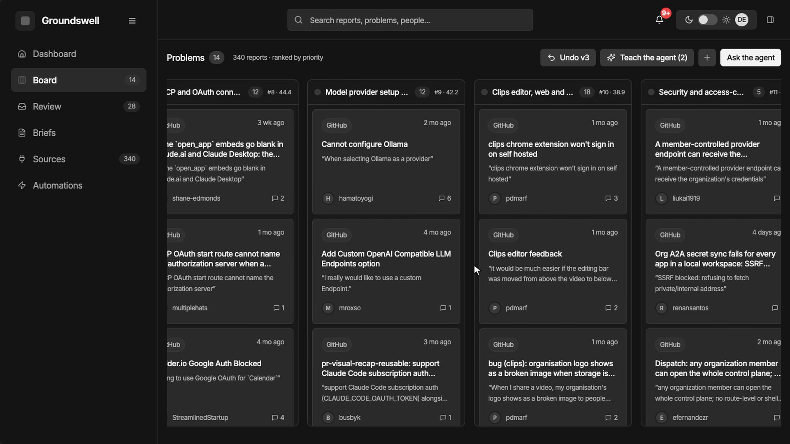
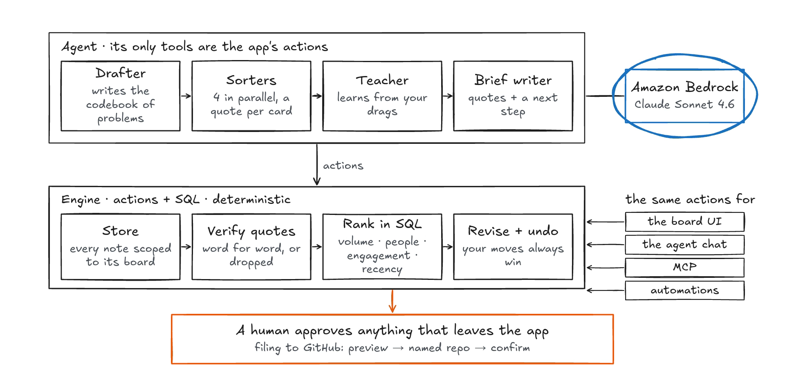

# Groundswell

**Turn a pile of feedback into ranked problems with real quotes, shaped by you and an agent together.**

Groundswell reads your GitHub issues, CSVs and notes, sorts them into problems ranked by real evidence, learns
from every card you drag, and files the top problems as GitHub issues. Every quote on the board is checked word
for word against the source, and every number comes from SQL, never from the model.

Built for the [Builder.io Agent-Native Hackathon](https://www.builder.io/hackathon) by **Favour Olaboye**.

- **Live app:** _added after deploy_
- **Demo video:** _added after upload_



## What it does

1. **The agent sorts everything.** Point it at a repo. The agent imports every issue, drafts a codebook of
   problems (definition plus include and exclude rules) and sends parallel sorter sub-agents through the notes.
   Each card lands with a quote, or stays in Unsorted when nothing fits.
2. **Every quote is real, every number is SQL.** The server rejects any quote that is not a verbatim substring of
   its report. Priority scores come from SQL: volume (duplicates collapsed), distinct people, engagement and
   recency, with a per-metric breakdown on every problem.
3. **Teach it by dragging.** Drag a card to the right problem and it is pinned, so the agent never moves it back.
   Your moves are recorded as corrections. The agent turns them into a proposed codebook revision (a before and
   after diff where every change cites your moves), and you apply or reject it. Applying re-sorts only the related
   reports, the cards it moved flash on the board, and undo restores every placement exactly.
4. **Ship it as an issue.** The agent writes an Insight Brief for a problem: what users hit, the impact, three to
   six verified quotes and one next step. Filing previews the issue, makes you name the repository and waits for
   your confirmation.
5. **It keeps working.** A GitHub webhook automation sorts new issues as they arrive, and a weekly digest reports
   what changed, through the same actions.

## Results on real data

The demo board is the public [BuilderIO/agent-native](https://github.com/BuilderIO/agent-native) issue tracker:
340 issues (665 bot issues skipped). Numbers below are from the board's SQL at the time of the demo.

| | |
| --- | --- |
| Problems found | 14 (plus 2 internal groups kept apart from the ranking) |
| Sorted into a problem | 327 of 340 (96%) |
| Agent-placed cards with a verified quote | 320 of 320 |
| Last codebook revision | learned from 4 moves, re-sorted 82 related reports, moved 21 |
| Quotes the server rejected in that re-sort | 10 (none reached the board) |

## Why it is agent-native

- **One set of actions for everyone.** Every capability is a single `defineAction` in [`actions/`](actions). The
  board UI, the agent chat, HTTP, MCP and automations all call the same actions; there are no parallel API routes.
- **The agent sees what you see.** The UI writes navigation and selection state; the agent reads it with
  `view-screen`, so "these cards" means the cards you selected.
- **Parallel sub-agents.** Sorting splits the notes into slices and runs sorter sub-agents side by side; the run
  record tracks progress and the board updates live.
- **Human edits win.** Cards you place are pinned. Anything that leaves the app (a GitHub issue) needs your explicit
  confirmation of the target repository.
- **Background work.** A webhook automation and a scheduled weekly digest run the same actions with no person in
  the loop; the digest is posted to the Inbox.



The editable diagram is [`docs/architecture.excalidraw`](docs/architecture.excalidraw).

## Stack

- [Agent-Native](https://agent-native.com) (`@agent-native/core` 0.226, Chat template), React Router 8, Nitro
- Drizzle ORM on PGlite locally and Neon Postgres in production
- Agent engine: Claude Sonnet 4.6 on Amazon Bedrock ([`server/lib/bedrock-engine.ts`](server/lib/bedrock-engine.ts))
- Tailwind 4, shadcn/ui and Radix, lucide icons

## Run it locally

Requires Node 22.22 or newer and pnpm.

```bash
pnpm install
cp .env.example .env    # then fill in the values below
pnpm dev                # http://localhost:8080, sign in with "Continue as local dev"
pnpm action seed-demo-board   # import the BuilderIO/agent-native issues onto a demo board
```

Then open the board and ask the agent to sort it, or run `pnpm test` and `pnpm typecheck`.

### Configuration

| Variable | Purpose |
| --- | --- |
| `AMAZON_BEDROCK_API_KEY` | Bedrock API key for the agent. Without it the AWS SDK credential chain is used (for example an `aws login` session). |
| `DATABASE_URL` | Postgres connection string in production (Neon). Local dev uses PGlite in `data/`. |
| `GITHUB_TOKEN` | Higher rate limits for imports; required for filing briefs as issues. |
| `BETTER_AUTH_SECRET` | Stable auth secret for production deploys. |
| `AGENT_NATIVE_SELF_DISPATCH_URL` | The app's own URL, so background automations and sub-agents reach the server. |

## Pre-existing work and what was built for the hackathon

**Pre-existing, not built for this project**

- **Agent-Native Chat template** by Builder.io (`npx @agent-native/core create --template chat`): the app shell,
  agent chat, auth, live sync, durable threads, sub-agent teams, automations and the framework skills under
  `.agents/skills`.
- **Twisky UI** (Favour's earlier project, [twiskylandingpage](https://github.com/Pavilion-devs/twiskylandingpage)):
  the dashboard shell, board columns and cards, drawer and landing page were ported from it and restyled with
  Groundswell's data and copy. See [`DESIGN.md`](DESIGN.md).
- **Libraries:** React Router, Drizzle, PGlite, Tailwind, shadcn/ui, Radix, lucide-react, the Vercel AI SDK,
  `@anthropic-ai/bedrock-sdk`, zod.
- **Data:** the public issues of [BuilderIO/agent-native](https://github.com/BuilderIO/agent-native), imported
  through the GitHub API. Report titles, bodies and author handles belong to their authors.

**Built for this hackathon**

- The data model and every action in [`actions/`](actions): imports (GitHub, CSV, text, webhook ingest), codebooks,
  sorting runs with parallel sorters, quote verification, corrections, codebook revisions with targeted re-sort
  and exact undo, SQL priorities, duplicate groups, Insight Briefs, issue filing, digests.
- The agent skill that drives those actions ([`server/agent-resources/feedback-synthesis.ts`](server/agent-resources/feedback-synthesis.ts)) and its system prompt.
- The Bedrock engine adapter and the Meta engine adapter.
- The Groundswell screens: board, dashboard, review, problem and report drawers, teach-the-agent review sheet,
  briefs, sources, automations and the landing page.
- The architecture diagram and the demo video (built with HyperFrames in [`video/`](video); voice-over and music
  from HeyGen).
